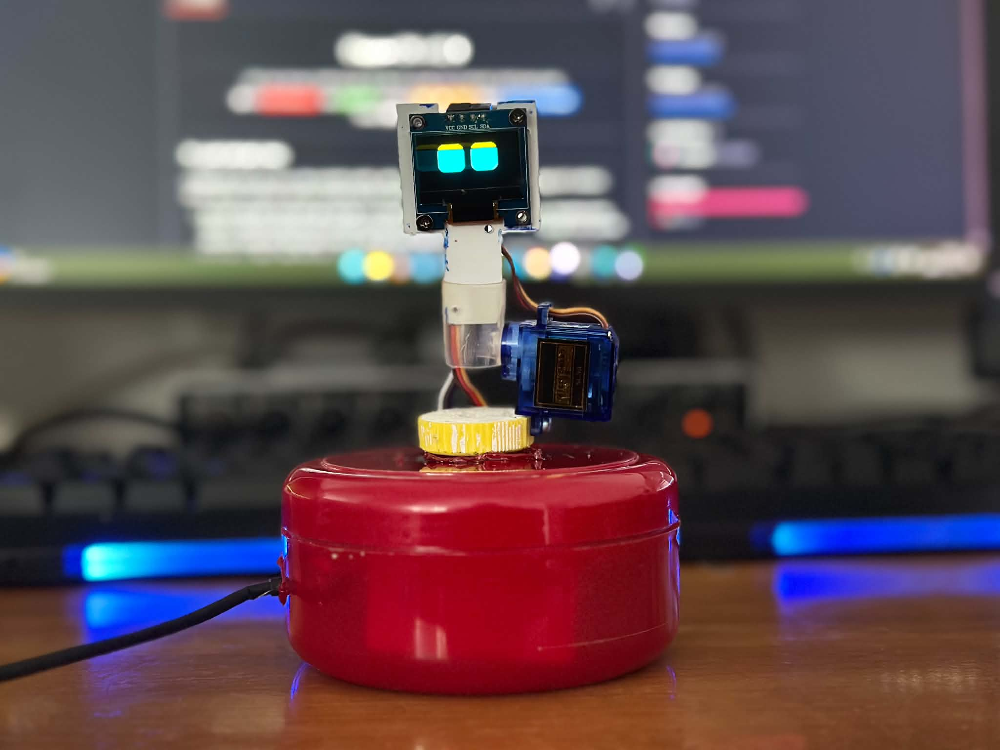

<div align="center">

  <h1>DipperOS v12.9</h1>

  <p><sub>ESP32-alapú kétmagos FreeRTOS RobotPet, R81 SBUS FPV szimulátor-híd és 2.4 GHz Wi-Fi / BLE RF elemző eszköz</sub></p>

  <p>
    
    
    
    
    
  </p>

  <br />

  

</div>

---

## Projektáttekintés

A **DipperOS v12.9** egy ESP32 mikrovezérlőre épülő, valós idejű FreeRTOS alapú multifunkciós beágyazott rendszer, amely egyetlen eszközben egyesíti az alábbi négy fő alrendszert:

1. **Smooth RobotPet (Animatronikus droid):** 2 szabadságfokú fejmozgatás (sebességkorlátozott, rángatásmentes szervó + 28BYJ-48 léptetőmotor automatikus tekercs-lekapcsolással), `FluxGarage_RoboEyes` animált OLED szemek, autonóm viselkedési állapotgép (FSM) és mély glissando alapú hangszintetizátor.
2. **RadioMaster TX12 / R81 SBUS RC vezérlés és FPV Szimulátor:** Hardveresen invertált 100 kbps SBUS dekóder dedikált FreeRTOS szálon, amely egyszerre támogatja a robot közvetlen kézi irányítását, a vezeték nélküli **BLE HID Gamepad** (`TP-Link_BLE`) FPV szimulátor módot és az USB soros `$SBUS` hidat.
3. **2.4 GHz Wi-Fi & BLE RF Audit / IDS:** Aszinkron Wi-Fi hálózat- és spektrumelemzés, automatikus nyílt (Free Wi-Fi) hálózat-detektálás, promiszkuus 802.11 csomag-szimatoló (Probe, Beacon, Deauth IDS riasztás, PPS grafikon), valamint NimBLE alapú BLE közelségi radar és tracker-kereső.
4. **Beágyazott Web UI és CLI (`192.168.4.1`):** Stealth SoftAP (`TP-Link_A4F8`) mögött futó, 4 füles webes vezérlőpult élő virtuális OLED tükörrel, interaktív terminállal (CLI), RF oszcilloszkóppal/vízesés-diagrammal és virtuális kétkaros RC kontrollerrel.

---

## Hardveres bekötés (Pinout)

Az alábbi táblázat a forráskódban definiált pontos GPIO-kiosztást tartalmazza (ESP32 DevKit v1 / WROOM-32).

| Periféria | Modul / Típus | ESP32 GPIO | Tápellátás | Műszaki megjegyzés |
|---|---|---|---|---|
| **OLED kijelző** | SSD1306 128×64 (I2C, `0x3C`) | `SDA`: **GPIO 21**<br>`SCL`: **GPIO 22** | 3.3 V + GND | 400 kHz Fast-Mode I2C (`Wire.setClock(400000)`) |
| **RC vevő (SBUS)** | RadioMaster R81 / FrSky SBUS | `RX2`: **GPIO 16** | 5 V + GND | `100000` baud, `8E2`, `SBUS_INVERT = true` (hardveres UART inverzió, külső inverter nem szükséges) |
| **Szervómotor** | SG90 / MG90S (fej bólintás / pitch) | `PWM`: **GPIO 13** | Külső 5 V + **közös GND** | 50 Hz, 500–2400 µs, középállás 1450 µs (90°), tartomány 15°–165° |
| **Léptetőmotor** | 28BYJ-48 + ULN2003 meghajtó | `IN1`: **GPIO 14**<br>`IN2`: **GPIO 27**<br>`IN3`: **GPIO 26**<br>`IN4`: **GPIO 25** | 5 V + **közös GND** | `Stepper(2048, 14, 26, 27, 25)` sorrend (`IN1, IN3, IN2, IN4`); ±60° tartomány, cél elérésekor tekercsek lekapcsolva |
| **Hangszóró / Buzzer** | Passzív piezo buzzer | `SIG`: **GPIO 23** | GND | `tone()` / `noTone()` alapú glissando droid hangmotor |
| **Akkumulátor mérés** | 1:1 feszültségosztó (1S LiPo) | `ADC`: **GPIO 35** | — | 2× szorzó (`mv * 2.0 / 1000.0`); 3.30–4.20 V → 0–100%; `<2.80V` vagy `>4.35V` esetén `USB 5.0V` mód |

### Bekötési vázlat (ASCII)

```text
                       +----------------------+
                       |      ESP32-WROOM     |
  +--------------+     |                      |     +-------------------+
  | SSD1306 OLED |     | GPIO 21 (SDA)  <---->|---->| SDA               |
  | 128x64 (0x3C)|     | GPIO 22 (SCL)  <---->|---->| SCL   OLED 3.3V   |
  +--------------+     |                      |     +-------------------+
                       |                      |
  +--------------+     |                      |     +-------------------+
  | R81 SBUS RX  |---->| GPIO 16 (RX2)        |     | ULN2003 + 28BYJ48 |
  | (5V, GND)    |     |                      |---->| GPIO 14 -> IN1    |
  +--------------+     |                      |---->| GPIO 27 -> IN2    |
                       |                      |---->| GPIO 26 -> IN3    |
  +--------------+     |                      |---->| GPIO 25 -> IN4    |
  | Servo (5V)   |<----| GPIO 13 (PWM)        |     +-------------------+
  +--------------+     |                      |
                       |                      |     +-------------------+
  +--------------+     |                      |---->| Passive Buzzer    |
  | 1S LiPo ADC  |---->| GPIO 35 (100k/100k)  |     | GPIO 23 (+) / GND |
  +--------------+     +----------------------+     +-------------------+
```

> **Fontos tápellátási megjegyzés:** A szervómotor és a 28BYJ-48 léptetőmotor indítási áramlökése meghaladhatja az USB-port vagy az ESP32 belső regulátorának terhelhetőségét. A stabil működéshez ajánlott külső 5 V-os tápforrás (vagy megfelelő BEC) használata a motorokhoz **közös GND** összekötéssel. A firmware a `RTC_CNTL_BROWN_OUT_REG` regiszterrel letiltja a túlzottan érzékeny brown-out resetet, de a megfelelő tápellátás elengedhetetlen.

---

## Rendszerarchitektúra (FreeRTOS kétmagos ütemezés)

A DipperOS a valós idejű RC-jelfeldolgozást, a sima motorvezérlést és a Wi-Fi/BLE hálózati stack-et szigorúan szétválasztja az ESP32 két processzormagja között:

| Feladat / Szál | CPU Mag | Prioritás | Ciklusidő | Felelősségi kör |
|---|---|---|---|---|
| **`sbusTask`** | Core 0 | 1 | 4 ms | 25 bájtos SBUS keretek olvasása (`0x0F` fejléc, failsafe ellenőrzés, 3500 µs szinkron-timeout) Wi-Fi lag nélkül |
| **`motorTask`** | Core 1 | 2 | 4 ms | `Stepper.h` léptetés + inaktív tekercs-lekapcsolás; 50 Hz-es, max. 2.5°/20 ms sebességkorlátozott szervósimítás |
| **`loop()` (Main)** | Core 1 | 1 | Folyamatos | WebServer, BLE HID (70 Hz), akkumulátor-ADC, RobotPet FSM, Wi-Fi/BLE szkenner, 802.11 sniffer, fizikai OLED (30 FPS) |

---

## RadioMaster TX12 (R81 SBUS) vezérlési kiosztás

A távirányító karjai **automatikusan aktívak**, amint az R81 vevő élő SBUS kereteket küld és az `AUTO PET` mód ki van kapcsolva (alapértelmezett állapot).

| TX12 vezérlő | SBUS csatorna | Funkció | Állapotok / Tartomány |
|---|---|---|---|
| **Jobb kar (Fel–Le)** | CH2 (`sbusCh[1]`) | Fej szervó (Pitch) | `15° .. 165°` (±25 holtsáv a 992 középérték körül → `90°`) |
| **Bal kar (Balra–Jobbra)** | CH4 (`sbusCh[3]`) | Léptetőmotor (Pan/Tilt) | `-60° .. +60°` (±25 holtsáv → `0°`) |
| **SA kapcsoló** | CH5 (`sbusCh[4]`) | Üzemmód váltás | Alacsony/Közép: `MANUAL RC` · Magas: `AUTO PET` (AI FSM) |
| **SB kapcsoló** | CH6 (`sbusCh[5]`) | Hangulat (RoboEyes + Hang) | Alacsony: `NORMAL` · Közép: `HAPPY` (+chirp) · Magas: `ANGRY` (+growl) |
| **SC kapcsoló** | CH7 (`sbusCh[6]`) | Extra & Droid beszéd | Alacsony: `NORMAL` · Közép: `TIRED` · Magas: `HAPPY` + `"SZIA"` beszéd |
| **SD kapcsoló** | CH8 (`sbusCh[7]`) | Hang & Wi-Fi Scan | Alacsony: `Audio ON` · Közép: `Audio MUTE` · Magas: Azonnali Wi-Fi Scan |

---

## Fizikai OLED vs. Virtuális Web OLED

A rendszer két párhuzamos kijelző-puffert kezel:
* **Fizikai 128×64 OLED (prioritási sorrendben):**
  1. `! FREE WI-FI !` riasztás (nyílt hálózat észlelésekor 5.5 mp-ig + hangjelzés + fejemelés).
  2. Módváltó bannerek (`MODE: AUTO PET`, `MODE: MANUAL RC`, `MODE: SIMULATOR`, `SIM / BLE HID`).
  3. Aktív Wi-Fi scan / BLE radar / 802.11 sniffer folyamatjelző sáv.
  4. `FluxGarage_RoboEyes` animált szemek (pislogás, idle mozgás, hangulatok, Deauth támadásnál `ANGRY`).
* **Webes Virtuális OLED (`192.168.4.1`):** Teljes 1024 bájtos 1-bites framebuffer tükör 4 választható színtémával (`ORANGE`, `CYAN`, `MATRIX`, `WHITE`), érintőképernyős swipe/tap és billentyűzetes navigációval.

---

## Web UI, CLI és REST API végpontok

Csatlakozás a beépített Stealth Access Pointhoz:
* **SSID:** `TP-Link_A4F8`
* **Jelszó:** `12345678`
* **Webes felület:** `http://192.168.4.1`

### Elérhető HTTP API végpontok

| Végpont | Metódus | Leírás |
|---|---|---|
| `/` | `GET` | A teljes 4 füles Web UI (`[1] OLED`, `[2] CLI`, `[3] RF`, `[4] PET`) kiszolgálása |
| `/api/screen` | `GET` | 1024 bájtos nyers bináris virtuális OLED framebuffer (`application/octet-stream`) |
| `/api/btn?k=L\|R\|OK\|BACK` | `GET` | Virtuális gombesemény feldolgozása és frissített OLED framebuffer visszaadása |
| `/api/cli?q=<cmd>` | `GET` | Terminál parancsok (`help`, `neofetch`, `wifi`, `scan wifi`, `sniffer`, `ble`, `scan ble`, `sbus`, `say <txt>`, `theme`, `maze`) |
| `/api/telemetry` | `GET` | Valós idejű JSON telemetria (RAM, táp, Wi-Fi/BLE csúcsok, PPS/chLoad tömbök, SBUS 8 csatorna, rendszernapló) |
| `/api/pet?<params>` | `GET` | RobotPet vezérlés (`auto=0\|1`, `snd=0\|1`, `home=1`, `p=<15..165>`, `t=<-60..60>`, `mood=0..3`, `chirp=1`, `say=<txt>`) |

---

## Fordítás és telepítés (Arduino IDE / PlatformIO)

### Szükséges könyvtárak

Telepítsd az alábbi könyvtárakat az Arduino Library Managerből (ESP32 Arduino Core 2.x / 3.x támogatással):

* `Adafruit GFX Library`
* `Adafruit SSD1306`
* `NimBLE-Arduino`
* `FluxGarage_RoboEyes`
* `ESP32Servo`
* `Stepper` *(beépített Arduino könyvtár)*

### Ajánlott board beállítások (Arduino IDE)

* **Board:** `ESP32 Dev Module`
* **Partition Scheme:** `Huge APP (3MB No OTA/1MB SPIFFS)` *(ajánlott a Wi-Fi + NimBLE + Web UI kombináció miatt)*
* **CPU Frequency:** `240 MHz (WiFi/BT)`
* **Upload Speed:** `921600`

---

## Ajánlott Git repozitórium struktúra

```text
DipperOS/
├── DipperOS.ino          # Fő ESP32 firmware (v12.9)
├── README.md             # Műszaki dokumentáció és bekötési útmutató
├── docs/                 # Bekötési rajzok, fotók, képernyőképek
└── .gitignore            # Build és IDE ideiglenes fájlok kizárása
```

> **Jogi és etikai megjegyzés:** A projekt Wi-Fi és BLE elemző/sniffer moduljai kizárólag saját hálózatok oktatási, diagnosztikai és biztonsági tesztelésére szolgálnak.